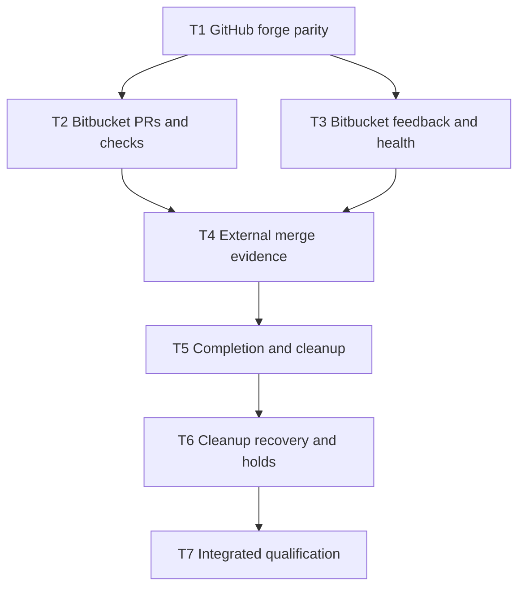

# Forge adapters and task completion

Revision 3. Authorized on 4 November 2026. Triage role ready-for-agent.
This contract supersedes the earlier plan that excluded the completion module.
Revision 3 replaces the private Bitbucket CLI dependency with REST transport owned by Shepherdr.
The [adapter reference](forge-adapter-reference.md) distinguishes current code from required behavior.

## Problem Statement

Shepherdr's GitHub knowledge is spread across task commands, observers and worktree presentation. Bitbucket tasks cannot follow the same complete workflow. An externally merged task can retain processes and worktrees without a truthful incomplete-cleanup outcome.

## Solution

Build one forge module with GitHub and Bitbucket Cloud adapters first. Then build one task-completion module that owns verified integration, base synchronization, pending or held cleanup, and confirmed resource removal. Reuse existing local Git, process-ownership and browser-custody modules. Preserve existing conversations and Azure configuration.

## User Stories

1. As Nathan, I want GitHub tasks to behave as before, so that existing projects remain usable.
2. As Nathan, I want Bitbucket tasks to use the same workflow, so that Experience SDK can adopt Shepherdr.
3. As a coordinator, I want the origin to identify the forge, so that work reaches the correct repository.
4. As a coordinator, I want aliases and rewrites preserved, so that existing connections still work.
5. As a reviewer, I want provider-qualified PR identity, so that identical PR numbers cannot collide.
6. As Nathan, I want existing GitHub task records preserved, so that conversations can continue.
7. As a worker, I want one draft PR for my task, so that retries do not create duplicates.
8. As Nathan, I want the correct PR link in the UI, so that I can inspect the actual candidate.
9. As a reviewer, I want checks bound to the candidate commit, so that old successes cannot approve new work.
10. As a coordinator, I want incomplete check pages visible, so that partial data cannot pass.
11. As a worker, I want comments and review feedback delivered once, so that I can act without duplicate work.
12. As a coordinator, I want failures on the selected base reported, so that integrated problems are visible.
13. As Nathan, I want approval bound to the reviewed source and destination, so that changed work requires fresh approval.
14. As Nathan, I want unsupported native merge guarantees refused, so that the application does not pretend to protect my approval.
15. As Nathan, I want an external squash merge recognized, so that my current Bitbucket workflow remains usable.
16. As a coordinator, I want integration verified against fetched destination history, so that a pasted claim cannot finish a task.
17. As Nathan, I want an advanced destination supported, so that unrelated later commits do not prevent valid completion.
18. As Nathan, I want dirty, ahead or diverged base state held, so that completion cannot overwrite local work.
19. As Nathan, I want owned processes and helpers confirmed stopped, so that completed work consumes no unexplained resources.
20. As Nathan, I want the owned worktree directory, registration and unchanged merged local branch removed, so that cleanup is complete.
21. As a worker, I want dirty files, later commits and replacement resources preserved, so that cleanup cannot erase newer work.
22. As Nathan, I want integration and cleanup reported separately, so that a merged task cannot hide retained resources.
23. As a coordinator, I want duplicate and interrupted completion to reconcile existing state, so that retries cannot repeat integration or unsafe deletion.
24. As a reviewer, I want task history, reviewed identities and receipts retained, so that I can audit completion after the checkout is gone.
25. As Nathan, I want both execution hosts qualified independently, so that one successful fixture does not imply the other is safe.
26. As Nathan, I want my Azure preview unchanged, so that this work cannot disrupt the setup I am trying.

## Implementation Decisions

- Follow the architecture HTML order. First deepen the forge module. Then deepen the task-completion module. Neither is replaced by a thin command wrapper.
- The forge module owns provider identity, repository resolution, PR operations, write reconciliation, check interpretation and feedback interpretation.
- GitHub and Bitbucket Cloud are real adapters. Task callers, observers and worktree presentation share the forge interface.
- Keep local Git, approval and durable message delivery with their existing owners.
- Preserve existing GitHub records. Bind new observations to provider, repository, PR, source commit and destination.
- Preserve the existing gh transport. Put Bitbucket Cloud REST transport inside Shepherdr's adapter. No bb executable, npm package, Monash plugin, fixed account, or private credential store is required.
- Reuse source only after verifying its licence and preserving required attribution. No reusable licence was found in the inspected Monash package or source tree. Implement from official API contracts unless reuse permission is established.
- Bind credentials and requests to the repository's admitted execution host. Preserve the checked-command broker. A direct request from the application server is not a substitute for a supported remote or contained route.
- Commit-bound complete checks and verified write outcomes remain adapter responsibilities. API acceptance does not prove integration. The [REST transport decision](adr/0002-bitbucket-rest-transport.md) records the design and remaining implementation choices.
- Refuse unsupported contained execution before effects. Preserve the existing checked-command broker.
- Preserve exact-commit approval and source-branch retention. Bitbucket native merge refuses when the provider cannot enforce the required source-head guarantee. Manual integration followed by verified observation remains supported.
- Completion consumes verified forge evidence and owns durable outcomes for integration, base synchronization, cleanup pending, cleanup held and cleanup complete.
- Reuse process ownership, local Git and browser custody. Revalidate resource identity before removal. A finished native turn is not a cleanup receipt.
- Confirm process exits and directly inspect directory, Git registration and local branch absence before reporting full cleanup.
- Preserve task records, conversations, review/source identity, PR link, merge evidence and receipts.
- For external-completion reconciliation, dirty, ahead, diverged or unavailable base state is a hold as required by SEBC-03. Preserve existing native GitHub and no-change contracts. Tests that previously allowed retained resources must not be relabelled as full-cleanup proof.
- Persist enough identity to reconcile duplicates, concurrent calls, lost replies and restart. Never repeat a merge to recover cleanup.
- Use the existing FORG-1 worker for the first ticket. Every execution worker uses Monash Azure Foundry Codex Sol 6.1 High with Fast. Verify native metadata when each starts.
- Use one bounded implementation task at a time while the coordinator owns the dependency graph. A dependency becoming available is not merge or deployment authority.

## Testing Decisions

- The primary seam is the supported task command or action. Assert public results, reopened persisted state, actual Git histories, process identities and filesystem postconditions.
- Shared forge-interface tests cover both real provider adapters using independent fixture expectations. They supplement public task tests.
- Prior art is the existing core task, GitHub observer, local Git, task-process and held-work test suites.
- Prove GitHub compatibility, provider identity mismatch, stale heads, retargeted PRs, missing or incomplete checks, later feedback pages and unknown writes.
- Prove external squash integration, destination advancement, wrong merge evidence, dirty and untracked work, later commits, changed worktree ownership and foreign holders.
- Prove duplicate calls, competing calls, interrupted stages, reopened state and branch advancement during cleanup.
- Verify removed directory, registration and unchanged local branch independently. Seed conversations and assert their retention.
- Run only typecheck locally. Repository CI owns tests and builds. Independent review checks the exact candidate.
- Native qualification on Mini and laptop requires a separately authorized isolated trial. Source tests and no-change tasks do not count as native Bitbucket proof.

## Out of Scope

Additional forges, Bitbucket Server or Data Center, account or credential redesign, model-selector changes, shared launchers, remote branch deletion, broad disk cleanup, forced deletion, new background automation, SDK migration, merge, release and deployment.

## Further Notes

The architecture report's two modules and its four delivery steps are authoritative for this correction. Scope remains SFA-01 through SFA-10 and SEBC-01 through SEBC-10. The canonical specifications retain their history.

Throughput checkpoint:
- Blocking first step is GitHub extraction with saved-identity compatibility.
- Bitbucket publication/checks and feedback/base-health are independent slices after that interface, but execution is serialized to limit overlapping writes.
- Shared state is the integrated candidate and native task dependencies. Each ticket has its own worktree. The foreground owner admits prerequisite commits before dependent execution.
- The smallest safe decomposition is the seven-ticket graph below. Code acceptance and native qualification remain distinct.

## Ticket dependency graph

T1 reuses FORG-1. The coordinator publishes T2 through T7 as native tasks and records their returned IDs. Native dependency satisfaction and code availability must both be established before starting a child. Never mark a parent complete merely to release a child.

## Finish line

GitHub behavior remains compatible. Bitbucket task publication, checks, feedback and verified external merge observation work through the shared forge module. The completion module reports verified integration separately from held or finished cleanup. Full cleanup removes only proven task-owned resources and retains history. Focused tests, required CI and independent review pass. Native qualification limits are disclosed until separately authorized proof exists.
